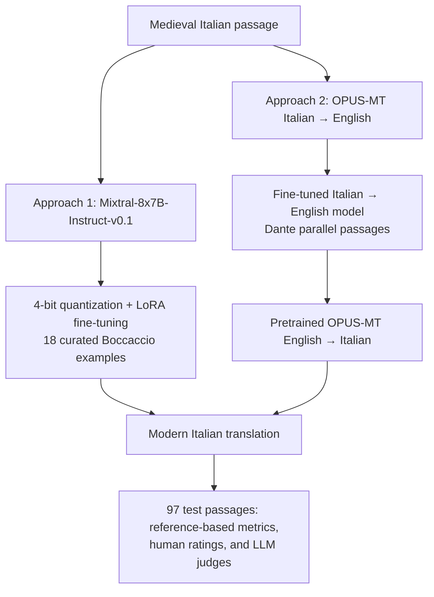
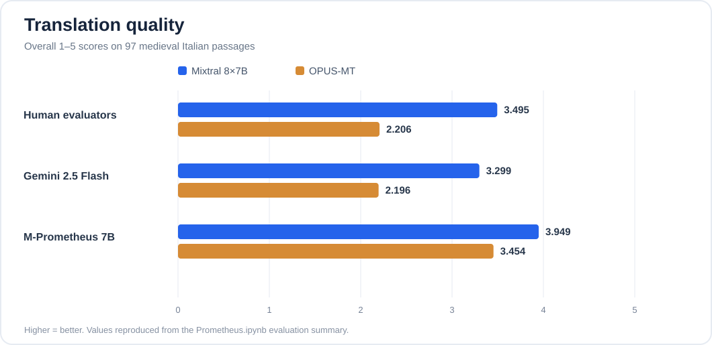
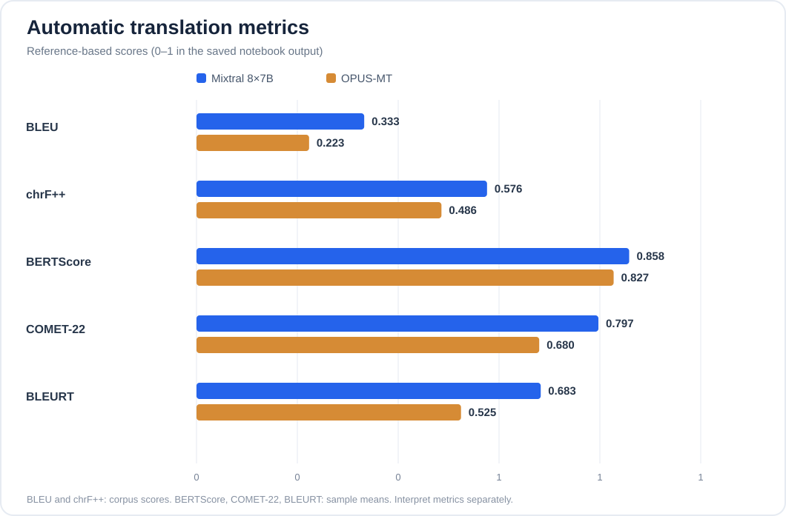
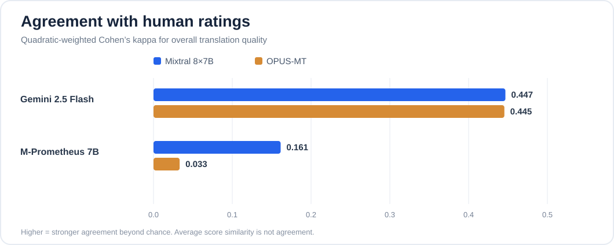

# The Twin Scribes
### Translating medieval Italian with fine-tuned language models

**MNLP — Homework 2** · 2025 · Alessio Olivieri & Giovanni Regina

This project studies how well neural language models can turn **medieval/archaic Italian (roughly 13th–15th century)** into readable **modern Italian**, without losing the original meaning. We compare a parameter-efficiently fine-tuned mixture-of-experts language model with an Italian → English → Italian translation pipeline, then ask **human annotators and LLM judges** to rate the results.

> **Main finding:** Mixtral achieved **3.49/5** in human-rated overall translation quality, compared with **2.21/5** for OPUS-MT, across **97 evaluated passages**. However, automated judges did not always agree with people—especially M-Prometheus on overall ratings.

[**Results**](#results) · [**Models**](#two-translation-approaches) · [**Evaluation**](#how-we-evaluated-translations) · [**Reproducing the notebooks**](#running-the-project) · [**Original report**](main.tex)

## The task

Older Italian is challenging for contemporary translation systems: vocabulary and inflections have shifted, sentences can be syntactically unfamiliar, and a literal translation may preserve the words while losing the meaning.

The input consists of historical Italian passages; the output should be natural modern Italian with the semantics of the original intact. Evaluation uses a **97-passage test set** with human-written modern Italian reference translations.

## Two translation approaches



### 1. Mixtral + LoRA

We used [Mixtral-8x7B-Instruct-v0.1](https://huggingface.co/mistralai/Mixtral-8x7B-Instruct-v0.1), quantized to **4-bit** and adapted with **LoRA** on a very small set of **18 manually translated excerpts** drawn from Boccaccio's *Decameron* and *Il Filocolo*. Inference also used instruction prompts and in-context translation examples.

| Fine-tuning configuration | Value |
| --- | --- |
| Base model | Mixtral-8x7B-Instruct-v0.1 |
| Quantization | 4-bit |
| LoRA rank / alpha / dropout | 8 / 16 / 0.1 |
| Adapted modules | `q_proj`, `v_proj` |
| Trainable parameters | 3,407,872 / 46,706,200,576 (**0.0073%**) |
| Fine-tuning samples | 18 |
| Recorded fine-tuning time | ~30 minutes, 35 seconds |

Implementation: [`Mistral_finetuning.ipynb`](Mistral_finetuning.ipynb). The notebook and report describe runs on Kaggle/Colab-style GPU environments; the report mentions NVIDIA T4 GPUs.

### 2. OPUS-MT round-trip translation

The alternative uses two [Helsinki-NLP OPUS-MT](https://huggingface.co/Helsinki-NLP) models. We fine-tuned **`opus-mt-it-en`** on Italian/English parallel text drawn from Dante's *Divine Comedy*, then passed the English output through the pretrained **`opus-mt-en-it`** model to recover modern Italian.

The OPUS notebook records **4,314 training examples and 480 validation examples**, with **10 training epochs** configured for the Italian → English stage. Only the first stage was fine-tuned; the return translation used a pretrained model.

Implementation: [`Opus_finetuning.ipynb`](Opus_finetuning.ipynb). Parallel text is included in [`data/dante.csv`](data/dante.csv).

## Results

### Human and LLM-judge quality ratings



Overall translation-quality ratings use the same **1–5 rubric**, where 5 is best. The numbers below are **means over 97 samples**, extracted from the outputs stored in [`Prometheus.ipynb`](Prometheus.ipynb).

| Evaluator (overall quality, /5) | Mixtral | OPUS-MT |
| --- | ---: | ---: |
| **Human** | **3.495** | **2.206** |
| Gemini 2.5 Flash | 3.299 | 2.196 |
| M-Prometheus-7B | 3.948 | 3.454 |

**Mixtral scored higher with humans and both automated judges.** M-Prometheus was substantially more generous than the human raters, particularly for OPUS-MT.

### Automatic translation metrics



| Metric | Mixtral | OPUS-MT |
| --- | ---: | ---: |
| BLEU (corpus) | **0.333** | 0.223 |
| chrF++ (corpus) | **0.576** | 0.486 |
| BERTScore (mean) | **0.858** | 0.827 |
| COMET-22 (mean) | **0.797** | 0.680 |
| BLEURT (mean) | **0.683** | 0.525 |

Values are shown using the **0–1-scaled representation present in the notebook outputs**; do not confuse `0.333` with a conventional BLEU value printed as `33.3`. Metrics have different definitions, so compare models **within each metric**, not across metric types.

### Can LLMs judge translations like humans?



We compared the AI-assigned overall ratings against human ratings using **quadratic-weighted Cohen's κ**. This measures agreement at the *individual-passage level*, beyond chance—not just how similar the two average scores are.

| Judge vs human (overall-quality κ) | Mixtral | OPUS-MT |
| --- | ---: | ---: |
| **Gemini 2.5 Flash** | **0.447** | **0.445** |
| M-Prometheus-7B | 0.161 | 0.033 |

Gemini agreed with human judgments considerably better than M-Prometheus on the **overall-quality rubric**. The results vary by criterion: for M-Prometheus, quadratic κ on OPUS-MT was **0.361 for grammar** and **0.321 for semantics**, so the low overall-quality agreement should **not** be generalized to every rubric.

See [`cohen_kappa.ipynb`](cohen_kappa.ipynb) and [`Prometheus.ipynb`](Prometheus.ipynb) for agreement analysis.

## How we evaluated translations

Every generated translation was compared against the modern Italian reference using:

1. **Human annotation:** 1–5 ratings, with separate grammatical, semantic, and overall-quality assessments.
2. **LLM-as-a-judge:** [Gemini 2.5 Flash](https://ai.google.dev/gemini-api/docs/models) and 4-bit [Unbabel/M-Prometheus-7B](https://huggingface.co/Unbabel/M-Prometheus-7B), instructed to return a short critique and a 1–5 rating against a specified rubric.
3. **Machine translation metrics:** BLEU, chrF++, BERTScore, COMET-22, BLEURT (plus inverse TER computed in the notebook).
4. **Agreement analysis:** unweighted, linearly weighted, and quadratically weighted Cohen's κ for human versus automated ratings.

The scoring experiments and saved results are in [`Prometheus.ipynb`](Prometheus.ipynb), [`Prometheus_Gemini.ipynb`](Prometheus_Gemini.ipynb), [`evaluator.py`](evaluator.py), [`cohen_kappa.ipynb`](cohen_kappa.ipynb), and [`data/`](data/).

## Repository layout

```text
├── Mistral_finetuning.ipynb    # Mixtral quantization, LoRA training, inference
├── Opus_finetuning.ipynb       # Dante parallel text, OPUS-MT training, round-trip inference
├── Prometheus.ipynb            # Human/LLM comparison, MT metrics, Cohen's kappa
├── Prometheus_Gemini.ipynb     # Separate judging experiments
├── cohen_kappa.ipynb           # Agreement and confusion matrix analysis
├── evaluator.py               # Prometheus judging and translation metrics
├── data/                      # Inputs, translated samples, annotated results
├── delivery/                  # Submitted JSONL predictions and judgments
├── docs/assets/               # Charts generated from recorded results
├── main.tex                   # Project write-up (LaTeX)
└── NLP_Homework_2.pdf         # Homework specification
```

## Running the project

This is an **experimental notebook repository, not a packaged inference library**. The original runs used notebook environments and several local, Kaggle, Google Drive, or Google Colab paths. There is no single command that reproduces every experiment end-to-end.

```bash
git clone https://github.com/Alessio-Olivieri/MNLP-Homework2.git
cd MNLP-Homework2
```

1. Open **`Mistral_finetuning.ipynb`** or **`Opus_finetuning.ipynb`** in a GPU-enabled notebook environment.
2. Install the dependencies imported in that notebook (notably PyTorch, Transformers, Datasets, PEFT/Accelerate, pandas, and for quantized models, bitsandbytes).
3. Update hardcoded `/kaggle/...` and `/content/...` paths to the repository's `data/` files and verify the expected spreadsheet column names.
4. Run inference to produce translations, then inspect the provided scores or run the evaluation notebooks. Gemini judging additionally requires API access/credentials.

For simply **exploring the original results**, training is unnecessary: the scored spreadsheets under `data/`, JSONL files under `delivery/`, and stored notebook outputs already contain the experiment artifacts.

## Caveats

- **Small-data comparison:** Mixtral used only 18 curated fine-tuning examples, while OPUS-MT was trained on a much larger Dante parallel corpus. This is an exploration of *approaches*, not a controlled architecture benchmark.
- **Limited evaluation set:** the 97 passages give a useful comparison, not a robust estimate of performance across all medieval Italian genres or dialects.
- **Subjective grading:** text quality is hard to summarize with a 1–5 rubric. Some LLM scores have low per-item agreement with human raters despite similar means.
- **Reproducibility:** runtime assumptions, absolute paths, notebook state, and external model/API dependencies mean the notebooks may need edits to run from a clean environment.
- **Historical style:** readability and fidelity can conflict. Modernizing a passage may remove nuance, even if a metric improves.

## Authors and materials

**Alessio Olivieri** · **Giovanni Regina**

University project for **Multilingual Natural Language Processing (MNLP), Homework 2**.

The original study description is in [`main.tex`](main.tex); the assignment brief is [`NLP_Homework_2.pdf`](NLP_Homework_2.pdf). Figures in this README are generated from the numeric outputs already stored in the repository—not from new model runs.
